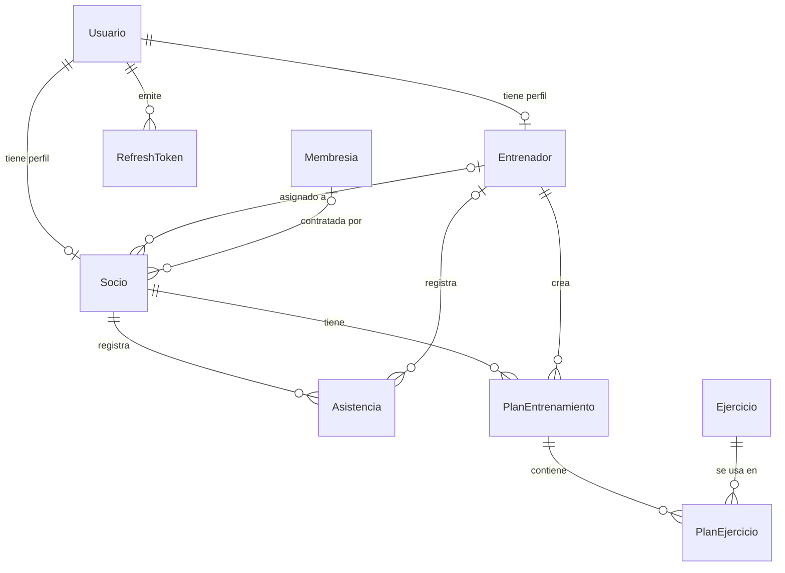

# Gimnasio API — versión CODE FIRST (migraciones)

API REST en **C# / .NET 8** para administrar socios, entrenadores, membresías, asistencias y planes de
entrenamiento de un gimnasio. Usa **Entity Framework Core + SQL Server** y seguridad **JWT** con roles
(**ADMIN, ENTRENADOR, SOCIO**).

En esta versión el esquema de la base de datos se define en el código (`Models/` + `Data/GimnasioDbContext.cs`)
y se crea con **migraciones**. La otra versión (`GimnasioApi-DbFirst`) hace lo mismo partiendo de un script SQL
con `Scaffold-DbContext`.

## Requisitos
- .NET SDK 8
- SQL Server (Express, LocalDB o Docker)
- Herramienta de EF Core: `dotnet tool install --global dotnet-ef --version 8.0.10`
- Postman

## Instalación y ejecución
1. Revisa `appsettings.json`:
   - `ConnectionStrings:Gimnasio` (base `BDGymMigraciones`). Con usuario/clave de SQL Server:
     `Server=localhost;Database=BDGymMigraciones;User Id=sa;Password=TuClave;TrustServerCertificate=True;`
   - `Jwt:Clave`: cámbiala por una clave propia de 32 caracteres o más.
2. **Genera la migración inicial** (una sola vez, crea la carpeta `Migrations/`):
   ```bash
   dotnet restore
   dotnet ef migrations add InitialCreate
   ```
3. Ejecuta la API. Al arrancar aplica las migraciones (crea la base de datos y las tablas), crea el
   procedimiento almacenado y siembra datos mínimos:
   ```bash
   dotnet run
   ```
   (equivalente manual de la parte de la base: `dotnet ef database update`)
4. Abre Swagger en `http://localhost:5000/` (el puerto real aparece en la consola).

Si luego cambias las entidades: `dotnet ef migrations add NombreDelCambio` y vuelve a ejecutar.

### Datos iniciales (se crean solos)
| Dato | Valor |
|---|---|
| Usuario ADMIN | `admin@gimnasio.com` / `Admin123*` (configurable en `AdminInicial`) |
| Membresías | Mensual, Trimestral, Anual |
| Ejercicios | 6 ejercicios de ejemplo |

## Roles y permisos
| Recurso | ADMIN | ENTRENADOR | SOCIO |
|---|---|---|---|
| Registrar/modificar/baja de entrenadores | ✅ | ❌ | ❌ |
| Registrar/modificar membresías | ✅ | ❌ (solo consulta) | ❌ |
| Registrar/modificar socios, asignar entrenador, renovar membresía | ✅ | ❌ | ❌ |
| Listar socios | Todos | Solo sus socios asignados | ❌ |
| Registrar asistencia | ✅ | Solo a sus socios | ❌ |
| Crear plan de entrenamiento | ✅ | Solo a sus socios | ❌ |
| Ver historial de asistencias y plan | Cualquier socio | Sus socios | Solo los propios |

Respuestas de seguridad: **401** sin token / token inválido o vencido, **403** rol insuficiente o recurso ajeno.

## Endpoints
| Método | Ruta | Acceso |
|---|---|---|
| POST | /api/auth/login | Público |
| POST | /api/auth/refresh | Público (con refresh token) |
| POST | /api/auth/logout | Autenticado |
| POST | /api/entrenadores | ADMIN |
| GET | /api/entrenadores?pagina=1&tamanio=5&buscar= | ADMIN |
| GET / PUT / DELETE | /api/entrenadores/{id} | ADMIN |
| POST | /api/membresias | ADMIN |
| GET | /api/membresias, /api/membresias/{id} | ADMIN, ENTRENADOR |
| PUT / DELETE | /api/membresias/{id} | ADMIN |
| POST | /api/socios | ADMIN |
| GET | /api/socios?pagina=1&tamanio=5&buscar=&soloVigentes= | ADMIN, ENTRENADOR |
| GET | /api/socios/{id} | ADMIN, ENTRENADOR (suyo), SOCIO (él mismo) |
| GET | /api/socios/mi-perfil | SOCIO |
| PUT | /api/socios/{id} | ADMIN |
| PUT | /api/socios/{id}/entrenador | ADMIN |
| PUT | /api/socios/{id}/membresia | ADMIN |
| DELETE | /api/socios/{id} | ADMIN |
| POST | /api/asistencias | ADMIN, ENTRENADOR (suyo) |
| GET | /api/asistencias/mi-historial | SOCIO |
| GET | /api/socios/{id}/asistencias?desde=&hasta= | ADMIN, ENTRENADOR (suyo), SOCIO (él mismo) |
| GET | /api/socios/{id}/asistencias/resumen | idem (usa procedimiento almacenado) |
| POST | /api/planes | ADMIN, ENTRENADOR (suyo) |
| GET | /api/planes/mi-plan | SOCIO |
| GET | /api/socios/{id}/planes, /api/socios/{id}/plan-activo | ADMIN, ENTRENADOR (suyo), SOCIO (él mismo) |
| GET / POST | /api/ejercicios | GET: autenticado · POST: ADMIN, ENTRENADOR |

### Ejemplo de login
```json
POST /api/auth/login
{ "email": "admin@gimnasio.com", "password": "Admin123*" }
```
Respuesta:
```json
{ "accessToken": "eyJ...", "accessTokenExpiraUtc": "...", "refreshToken": "...", "refreshTokenExpiraUtc": "...", "rol": "ADMIN", "perfilId": 0 }
```
Usa el token en cada petición: `Authorization: Bearer <accessToken>` (en Swagger, botón **Authorize**).

### Paginación
```json
{ "pagina": 1, "tamanioPagina": 5, "totalRegistros": 12, "totalPaginas": 3, "datos": [ ... ] }
```
Se hace en la base de datos (`COUNT` + `OFFSET/FETCH`). `tamanio` admite de 1 a 50.

### Formato de errores (middleware central)
```json
{ "status": 409, "error": "El socio ya registró su asistencia el día de hoy." }
```
400 validación · 401 no autenticado · 403 sin permiso · 404 no existe · 409 conflicto / duplicado / regla de negocio.

## Qué demuestra cada parte (rúbrica)
- **EF Core y BD**: entidades y relaciones con Fluent API, migraciones, relación muchos a muchos (`PlanEjercicio`),
  consultas LINQ con proyecciones, procedimiento almacenado (`usp_ResumenAsistenciasSocio`),
  **transacciones explícitas** (registrar socio/entrenador y crear plan) y manejo de errores de SQL Server
  (clave duplicada y llave foránea → 409).
- **JWT y roles**: autenticación sin estado, validación de emisor/audiencia/firma/vencimiento, `refresh token`
  con rotación y detección de reutilización (se guarda solo su hash), roles por endpoint.
- **Control de acceso**: política personalizada `AccesoSocio` (autorización por recurso) y respuestas 401/403 en JSON.
- **Calidad**: capas Controller → Servicio → Repositorio, DTOs con validaciones, middleware de errores, Swagger documentado.

## Pruebas con Postman
Importa `Gimnasio.postman_collection.json` y ejecuta las carpetas **en orden** (1 a 5) con el *Collection Runner*.
Cada request tiene tests; guarda las capturas para el informe técnico.
Para repetir la prueba completa borra la base o cambia los correos/documentos de ejemplo.

## Estructura
```
Controllers/   Dtos/   Servicios/   Repositorios/   Seguridad/   Middlewares/   Excepciones/
Models/        Data/ (GimnasioDbContext, InicializadorBD, DatosIniciales)   Migrations/ (la generas tú)
```

## Diagrama de entidades

